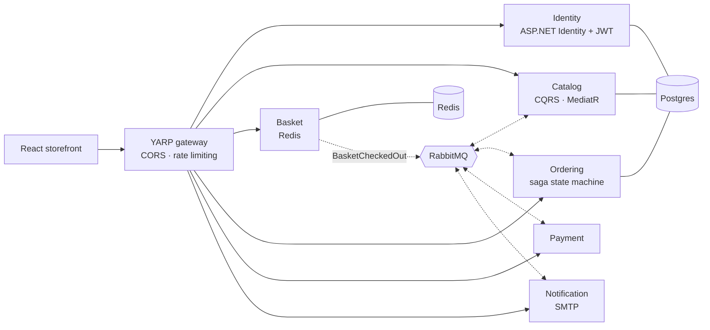
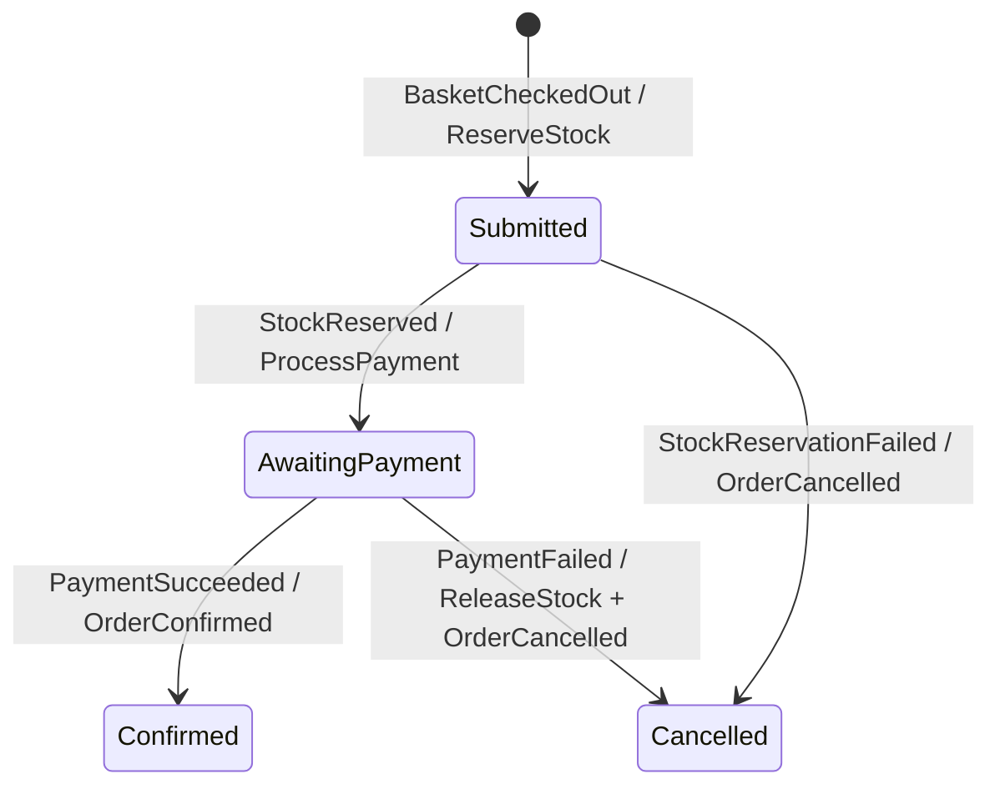

# ShopFlow

[](https://github.com/talhazubairasim/shopflow/actions/workflows/ci.yml)

An e-commerce platform built as **.NET 8 microservices** behind a **YARP API gateway**, with a
**React + TypeScript** storefront. Checkout is a distributed transaction run by a
**MassTransit saga** over **RabbitMQ**: stock is reserved, the card is charged, and if
anything fails the saga compensates (stock released, order cancelled, customer emailed).

## Architecture



| Service | Responsibility | Storage |
|---|---|---|
| **Identity** | Register / login, issues JWTs (`customer`, `admin` roles), lockout after 5 failures | Postgres |
| **Catalog** | Products, search, categories; CQRS with MediatR + FluentValidation; optimistic-concurrency stock reservations | Postgres |
| **Basket** | Per-user basket; re-prices every line from Catalog at checkout (resilient HTTP client) | Redis |
| **Ordering** | Owns the checkout saga and the order read model | Postgres |
| **Payment** | Simulated card processor: Luhn check, decline rules, idempotent per order | in-memory |
| **Notification** | Emails order confirmations / cancellations, keeps a per-user feed | MailHog (dev) |
| **Gateway** | Single entry point, routing, CORS, fixed-window rate limit per client | — |

Every service shares `ShopFlow.ServiceDefaults`: JWT validation, ProblemDetails errors,
Swagger, OpenTelemetry tracing/metrics, `/health/live` and `/health/ready`.

## The checkout saga



* Stock reservation is idempotent per order and uses a row version, so two buyers can't
  both take the last unit.
* The card number only lives in saga state until the payment request is sent.
* Late or duplicate messages after an order is settled are ignored.

## Run it

```bash
docker compose up --build
```

| | |
|---|---|
| Storefront | http://localhost:3000 |
| Gateway / APIs | http://localhost:5100 (Swagger on each service at `/swagger`) |
| RabbitMQ UI | http://localhost:15672 (guest / guest) |
| MailHog (emails) | http://localhost:8025 |

Sign in as **admin@shopflow.dev / Admin#2025** for the admin page, or create an account.
Test cards: `4242 4242 4242 4242` succeeds, `4000 0000 0000 0002` is declined, and
orders above $5,000 exceed the card limit. The *USB-C Hub* is seeded out of stock.

Then run the end-to-end script against the stack:

```bash
./scripts/e2e.sh
```

It registers a user and drives three checkouts through the gateway (confirmed, declined
with stock released, out of stock) and checks the notifications.

### Without Docker

Every service falls back to in-memory storage and the in-memory message bus when its
connection strings are empty, so each one can run alone:

```bash
dotnet run --project src/Services/Catalog/Catalog.Api   # http://localhost:5101
cd src/Web && npm install && npm run dev                # proxies /api to :5100
```

## Tests

```bash
dotnet test                 # services: unit, API and saga tests
cd src/Web && npm test      # storefront: Vitest + Testing Library
```

* **Saga tests** use the MassTransit test harness to play every path through the state
  machine, including compensation and duplicate messages.
* **API tests** boot each service with `WebApplicationFactory`, real JWTs and in-memory
  stores.
* **CI** builds and tests both halves, then brings up the full stack with Docker Compose
  and runs `scripts/e2e.sh`.

## Kubernetes

Manifests are in [`deploy/k8s`](deploy/k8s) (Kustomize): the six services with probes and
resource limits, the gateway and storefront behind an Ingress, and single-replica
Postgres / Redis / RabbitMQ for a demo cluster. See the header of
`kustomization.yaml` for the secret to create first.

## Project layout

```
src/
  BuildingBlocks/  ShopFlow.Contracts (integration events), ShopFlow.ServiceDefaults
  Services/        Identity, Catalog, Basket, Ordering, Payment, Notification
  Gateway/         YARP reverse proxy
  Web/             React 18 + Vite + Tailwind storefront
tests/             xUnit projects per service + shared test helpers
deploy/            Postgres init script, Kubernetes manifests
scripts/e2e.sh     End-to-end checkout test
```
